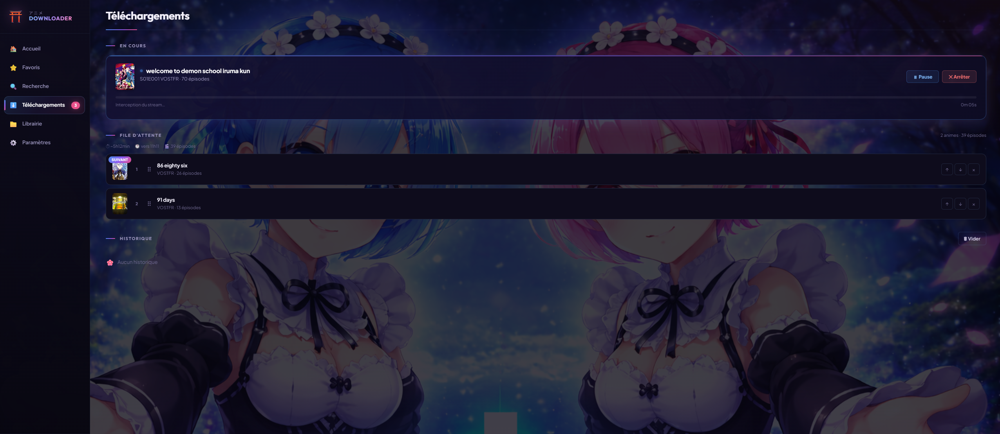

<div align="center">


# 🎬 Anime Downloader

**Rechercher, gérer et télécharger des animes & scans depuis Anime-Sama.**
**Application de bureau** locale (`.exe`) — serveur local sur `127.0.0.1` + fenêtre, 100 % hors-réseau.

Pipeline multi-moteurs · extraction avancée · lecteur intégré · file temps réel · reprise après coupure

<br>

[](https://www.python.org/)
[](https://fastapi.tiangolo.com/)
[](https://playwright.dev/)
[](#-installation-utilisateur-final)
[](#-licence)

<br>



</div>

---

> [!IMPORTANT]
> **Avertissement d'usage.** Cette application n'héberge, ne stocke et ne fournit aucun
> contenu. Elle pilote, depuis ta machine, un compte que tu possèdes déjà sur un site
> tiers, et n'est affiliée ni à ce site ni à aucun ayant droit. Tu restes responsable de
> ce que tu télécharges : respecte le droit d'auteur et les conditions d'utilisation de
> ta source.

## 🎯 C'est quoi ?

Une application de bureau qui cherche des animes et des scans sur Anime-Sama, intercepte
les flux vidéo chez les hébergeurs tiers et les télécharge en local. Elle tourne
entièrement sur ta machine : un serveur FastAPI sur `127.0.0.1:7843` et une fenêtre
WebView2, sans compte, sans cloud, sans exposition réseau.

Le binaire distribué embarque Chromium et tous les outils de téléchargement : la machine
cible n'a **rien à installer**.

---

## ✨ Fonctionnalités

### 🔍 Recherche & navigation
- Recherche en direct sur Anime-Sama, chargement dynamique des épisodes
- Gestion des saisons et des langues (VOSTFR / VF…)
- Favoris synchronisés, filtrés par type (**Animés** / **Scans**) + cache anti-spam réseau

### ⬇️ Téléchargement multi-moteurs
Le pipeline essaie les moteurs dans cet ordre, en s'arrêtant au premier qui aboutit
(`_cascade_download` dans [`pipeline.py`](engine/download/pipeline.py)) :

1. **N_m3u8DL-RE** — moteur HLS principal, très rapide
2. **yt-dlp** — repli généraliste
3. **ffmpeg** — dernier recours universel

- File d'attente réordonnable (drag & drop), lots multi-épisodes
- **Pause réelle** (suspend/reprend le process en cours, pas seulement entre épisodes)
- **Reprise après coupure** : les segments déjà téléchargés sont conservés et réutilisés
- **Anti-ban** : navigateur d'extraction **visible** (moins détecté par les hébergeurs), délais par domaine, **pénalité progressive** et **pause automatique** entre épisodes dès qu'un hôte limite le débit (429/403)

### 🧠 Extraction « forensic » — chaîne de repli garantie
Objectif : **dégrader, jamais abandonner**. Aucun épisode n'est bloqué faute d'extracteur.
Chaque maillon prend le relais si le précédent échoue ; on logue lequel a réussi
(`extract_via_*` dans `/api/metrics`) :

1. **yt-dlp direct** sur l'URL du lecteur (hôtes à extracteur natif yt-dlp)
2. **Interception réseau Playwright** — hooks `fetch`/`XHR` + **CDP Network** (URL + en-têtes réels)
3. **Scan DOM** — `video.src`, `<source>`, `data-*`, HLS.js / dash.js, shadow DOM
4. **Repli forensic** — regex HTML/JSON sur le contenu de page
5. **yt-dlp generic** puis **ffmpeg** en dernier recours sur le flux capturé

Flux normalisés : **HLS (`.m3u8`)**, **DASH (`.mpd`)**, **MP4/WebM direct**, plus le filet
générique « inconnu » qui tente le téléchargement de tout flux média sniffé au réseau.

### 🧩 Hébergeurs / lecteurs supportés (registre extensible)
La détection par hôte est un **registre façon yt-dlp** : un fichier isolé par hôte sous
[`engine/download/extractor/hosts/`](engine/download/extractor/hosts/), enregistré via
[`registry.py`](engine/download/extractor/registry.py). **Ajouter un hôte = ajouter un
fichier** (zéro `if` géant), avec ses en-têtes (`Referer`/`Origin`/`User-Agent`), sa
stratégie (yt-dlp ou interception) et ses `--extractor-args`.

| Hôte | Domaines | Stratégie | Flux |
|---|---|---|---|
| **sibnet** | `sibnet.ru` | yt-dlp natif | MP4 direct (Referer/Origin forcés) |
| **vidmoly** | `vidmoly.to/.me/.net/.biz` | interception | HLS via lecteur JS (Referer vidmoly) |
| **sendvid** | `sendvid.com` | yt-dlp natif | MP4 + HLS de secours |
| **doodstream** | `doodstream.com`, `dood.*`, `d000d.com`… | yt-dlp | CDN signé (Referer dood) |
| **vudeo** | `vudeo.io/.net/.co` | interception | MP4/HLS via lecteur JS |
| **streamtape** | `streamtape.com/.net/.to`, `streamta.pe`… | yt-dlp | Lien obfusqué DOM (Referer streamtape) |
| **uqload** | `uqload.io/.to/.com/.net/.co/.is` | interception | MP4 progressif derrière Cloudflare (Referer uqload) |
| **filemoon** | `filemoon.sx/.to/.in/.nl`… | yt-dlp | HLS packé (Referer filemoon) |
| **vk** | `vk.com`, `vkvideo.ru`, `vk.ru` | yt-dlp natif | extracteur natif (en-têtes gérés) |
| **ok** | `ok.ru`, `odnoklassniki.ru` | yt-dlp natif | extracteur natif (en-têtes gérés) |
| **myvi** | `myvi.ru`, `myvi.tv`, `myvi.top` | yt-dlp | extracteur yt-dlp (Referer myvi) |
| **mp4upload** | `mp4upload.com` | yt-dlp natif | MP4 progressif (Referer mp4upload) |
| **lulustream** | `lulustream.com`, `luluvdo.com`, `lulu.st`… | yt-dlp | HLS (Referer lulustream) |
| **vidhide** | `vidhide*.com`, `filelions.*`, `alions.pro`… | yt-dlp | HLS (Referer vidhide) |
| **streamwish** | `streamwish.*`, `embedwish.com`, `*wish.pro`… | yt-dlp | HLS (Referer streamwish) |
| **swishclone** | `dingtezuni.com`, `minochinos.com`, `movearnpre.com`… | interception | HLS (clone StreamWish, domaines tournants) |

Un dix-septième module, `oneupload`, reste au dépôt mais ses domaines figurent dans
`HOSTS_MORTS` ([`settings.py`](engine/config/settings.py)) : l'hébergeur est hors service
et les lecteurs qui le désignent sont ignorés d'office.

Un **seuil d'alerte** signale tout hôte dont le taux de succès passe sous **30 %** dès
**3** tentatives (`HOST_ALERT_SUCCESS_PCT` / `HOST_ALERT_MIN_ATTEMPTS`) : champ
`hotes_degrades` dans `/api/metrics` et bandeau « ⚠ Hôtes dégradés » dans la page
Diagnostic. Indicateur de **tendance** complémentaire du circuit breaker par hôte
(échecs consécutifs).

Tout hôte non listé tombe sur l'**extracteur générique** (interception + sniff média +
en-têtes capturés), donc reste téléchargeable. La liste vivante et le **taux de succès par
hôte** sont exposés dans `/api/metrics` (`hotes_supportes`, `par_hote`). Un **circuit
breaker par hôte** isole les hôtes en panne (`/api/download/breakers`).

### 📖 Scans (manga / manhwa)
- Téléchargement des chapitres par lot, empaquetés en **`.cbz`** (un fichier par chapitre)
- Lecteur intégré (webtoon vertical / manga, zoom, luminosité), lecture en ligne **ou** du `.cbz` local
- Dossier dédié (`SCANS_DIR`), indexés dans la même librairie que les animes

### 📚 Librairie & lecteur
- Lecteur vidéo intégré (reprise de lecture, raccourcis clavier, épisode suivant/précédent)
- Vue liste **et** vue « Netflix », détection des épisodes manquants, stats, export CSV
- Historique de téléchargements **persistant** (SQLite)

### ⚡ Temps réel & observabilité
- Progression live via **SSE** (Server-Sent Events), flux unique partagé par toute l'interface
- **`/api/health`** — état complet : file, auth (sans secret), moteurs détectés, navigateur, **disque**, **process** (uptime/pid/python), **clients SSE**, et l'**identité du build** (date de construction du paquet)
- **`/api/metrics`** — débit par moteur, succès/échecs, octets, profondeur de file (max), **latences p50/p95**, gauges, **taux de succès par hôte** (`par_hote`), maillon de repli gagnant (`extraction_par_lien`), hôtes supportés
- **Page « Diagnostic » intégrée à l'application** (entrée 🩺 de la barre latérale, ou depuis les Paramètres) — santé, métriques, latences, disjoncteurs et journal filtrable. Elle consomme le flux SSE partagé et **cesse de se rafraîchir dès qu'elle n'est plus à l'écran**
- **Logs corrélés** par identifiant de tâche (`[id]`), zéro secret

### 🛡️ Robustesse & sécurité
- Protection **SSRF** (validation des URLs + **IP-pinning** des fetch d'images/covers contre le DNS-rebinding), **CSP stricte sans `'unsafe-inline'`** (`script-src`/`style-src 'self'`, zéro inline)
- **En-têtes de sécurité sur toutes les réponses** (`nosniff`, `Referrer-Policy`, CSP sur le HTML), garde anti **DNS-rebinding** / **CSRF** (HostGuard)
- Identifiants & session **chiffrés** (cookies Fernet, clé au **trousseau OS** par utilisateur, `cookies.enc` en `0600`)
- Timeouts + watchdog sur chaque moteur, kill des arbres de process, circuit breakers par hôte
- Lecture HTTP bornée (anti-OOM), cache TTL + cache disque, retries intelligents
- **Persistance SQLite** : file d'attente + historique survivent au redémarrage

---

## 📦 Installation (utilisateur final)

Telecharge **`AnimeSama-Setup.exe`** depuis la [derniere release](https://github.com/floonbot/animesama/releases/latest) (~349 Mo), puis double-clique dessus. Installation **per-user** dans
`%LOCALAPPDATA%\Programs\AnimeSama`, **sans droits administrateur** — nécessaire parce que
l'application écrit `data/`, `downloads/` et `scans/` à côté de son exécutable. Le programme
d'installation pose les raccourcis menu Démarrer et Bureau, et installe le composant
d'affichage **WebView2** s'il manque.

**Tout est embarqué** : Chromium, N_m3u8DL-RE, yt-dlp, ffmpeg, aria2c et le runtime Python.
Aucune installation ni accès réseau n'est requis pour démarrer.

### Ce que devient ta configuration

| Situation | Comportement |
|---|---|
| **Réinstallation / mise à jour** | Tes données sont **conservées** : réglages, identifiants, historique, index de la bibliothèque. Le programme d'installation ne redemande pas le dossier de téléchargement et l'annonce sur son écran récapitulatif. |
| **Désinstallation** | Elle propose **trois cases indépendantes**, toutes décochées : les réglages (`data/`), les identifiants du trousseau Windows, les vidéos et scans téléchargés. Tu peux n'en cocher aucune. |
| **Vidéos et scans** | **Jamais touchés à l'installation.** À la désinstallation, seule la troisième case les supprime : décochée par défaut, confirmée une seconde fois, et refusée si le dossier configuré est une racine de disque. |
| **Désinstallation silencieuse** | Ne supprime **rien** : personne n'est là pour choisir. |

> L'exe n'est **pas signé** : au premier lancement, SmartScreen peut afficher un
> avertissement « éditeur inconnu ». Clique sur *Informations complémentaires* puis
> *Exécuter quand même*. Pour signer, voir [`packaging/sign.bat`](packaging/sign.bat).

---

## 🚀 Développement

> Prérequis : **Python 3.13+** et **Node.js**. Sous Windows, coche **« Add Python to PATH »**.

```bash
git clone https://github.com/floonbot/animesama.git
cd animesama
```

**1. Dépendances Python, Chromium et binaires** — un seul script fait tout :

```bat
packaging\install.bat
```
```bash
chmod +x packaging/install.sh && ./packaging/install.sh
```

Il installe `requirements/requirements.txt` + `requirements-desktop.txt` + Pillow
(optionnel), lance `python -m playwright install chromium`, télécharge
**N_m3u8DL-RE**, **yt-dlp**, **ffmpeg** et **aria2c** dans **`bin/`**, puis crée `.env`,
`downloads/`, `scans/` et `data/`.

Sous Linux / macOS le script ne télécharge pas les binaires : place-les dans `bin/` ou
dans le `PATH` (le code cherche `bin/` d'abord, puis `shutil.which`).

Pour des versions figées :

```bash
pip install -r requirements/requirements.txt -c requirements/constraints.txt
python -m playwright install chromium
```

**2. Bundle front — obligatoire.** `index.html` charge `/dist/app.js` et
`web/static/dist/` est git-ignoré : sur un clone frais, **l'interface reste blanche tant
que le bundle n'est pas construit**.

```bash
npm install
npm run build      # produit web/static/dist/
npm run watch      # reconstruit à chaque modification, pour le développement
```

Après toute modification de `web/static/js/**`, relance `npm run build` — sinon le
navigateur continue de servir l'ancien bundle. Au démarrage, le serveur compare les dates
et **avertit dans les logs** si `dist/` est plus vieux que `web/static/js/`.

**3. Lancer :**

```bash
python desktop.py
```

Une fenêtre s'ouvre immédiatement, affiche l'avancement du démarrage, puis bascule sur
l'application (serveur local **http://127.0.0.1:7843** + webview). Fermer la fenêtre
arrête proprement le serveur : le téléchargement en cours est préservé pour reprise, le
navigateur Playwright est fermé.

Pour lancer le serveur seul (sans fenêtre) — `server.py` n'a pas de point d'entrée
`__main__` :

```bash
python -c "import server; server.start_server()"
```

### Contribuer

```bash
pip install -r requirements/requirements-dev.txt

ruff check .        # lint  (E, F, I, B, UP, ASYNC ; ligne 100 ; cible py313)
mypy .              # typage
pytest -q           # tests
```

Les trois doivent passer **sans aucune erreur** avant chaque commit. Lance aussi
`pytest -q -p no:randomly` : une pollution d'état entre tests a déjà existé sur ce projet
et n'était visible qu'en ordre alphabétique.

Les tests E2E Playwright (`tests-e2e/`) se lancent avec `npm run test:e2e` ; ils démarrent
le serveur eux-mêmes (voir [`playwright.config.js`](playwright.config.js)). Si le port
7843 est déjà pris par une instance installée, passe `PORT=7851` pour tester contre un
serveur isolé.

---

## 🔨 Construire l'exécutable

```bat
BUILD.bat
```

(raccourci vers [`packaging/build_exe.bat`](packaging/build_exe.bat), en 5 étapes :
Python → prérequis → bundle esbuild → PyInstaller → Inno Setup)

Produit **à la racine du dépôt** :

| Sortie | Contenu |
|---|---|
| **`AnimeSama\`** | ~1,2 Go — `AnimeSama.exe` + `_internal\` (Chromium, binaires, front, runtime Python). C'est **le dossier entier** qui est autonome : zippe-le pour distribuer sans installeur. Le mode *one-file* n'est pas utilisé, il ré-extrairait ~1,2 Go dans `%TEMP%` à chaque lancement. |
| **`AnimeSama-Setup.exe`** | ~349 Mo — le programme d'installation ci-dessus. Généré via [Inno Setup](https://jrsoftware.org/isdl.php), que le script installe automatiquement s'il manque. |

Poids : Chromium complet ~459 Mo, `chrome-headless-shell` ~302 Mo, `bin/` ~145 Mo
(ffmpeg 109 Mo, yt-dlp 17 Mo, N_m3u8DL-RE 13 Mo, aria2c 5 Mo).

**Variables d'environnement du build :**

| Variable | Effet |
|---|---|
| `ANIMESAMA_HEADLESS_ONLY=1` | N'embarque que `chrome-headless-shell` (**−459 Mo**). Retire le navigateur complet : le sniff Playwright et la connexion ne fonctionnent plus. **Build de test uniquement, ne pas distribuer.** |
| `ANIMESAMA_NO_INSTALLER=1` | Saute l'étape Inno Setup ; seul le dossier `AnimeSama\` est produit. |

### Le raccourci lance l'installé, pas le dépôt

C'est le piège n°1 de ce projet : après un rebuild, le raccourci du Bureau continue de
lancer l'application **installée**, qui date du build précédent. Trois garde-fous :

- Le build **compare** le paquet fraîchement construit à l'installation détectée et affiche
  un bloc d'alerte explicite si elles diffèrent
  ([`verifier_installation.py`](packaging/verifier_installation.py)).
- Un `AnimeSama-Setup.exe` d'un build précédent est **renommé en `.PERIME.exe`** dès que la
  compilation de l'installeur n'a pas eu lieu — y compris avec `ANIMESAMA_NO_INSTALLER=1`.
- L'application **date son propre paquet** : ligne au démarrage dans les logs, et champ
  **Build** dans la carte « État » de la page Diagnostic. En développement elle affiche
  « sources de développement ».

La version applicative est déclarée une seule fois, dans
[`engine/version.py`](engine/version.py) ; le build l'injecte dans Inno Setup, et un test
vérifie que `pyproject.toml` et `installer.iss` ne divergent pas.

---

## ⚙️ Configuration

Tout est optionnel — l'app démarre avec des valeurs par défaut. Copie `.env.example` en `.env` pour personnaliser :

| Variable | Rôle (défaut) |
|---|---|
| `PORT` | port du serveur local (`7843`) ; l'hôte est **fixé à `127.0.0.1`** (loopback, non configurable) |
| `DOWNLOADS_DIR` / `SCANS_DIR` | dossiers de sortie vidéos / scans (`<projet>/downloads` et `/scans`) |
| `DL_MAX_RETRIES` / `DL_RETRY_DELAY` | tentatives par épisode (`1`), délai entre tentatives (`3` s) |
| `DL_PREFETCH` | préchargement de l'extraction de l'épisode suivant (désactivé par défaut ; `1`/`true`/`yes` pour activer) |
| `BROWSER_HEADLESS` / `BROWSER_CHANNEL` | navigateur d'extraction : **sans fenêtre par défaut** (`true` + canal `chromium`) — voir ci-dessous · `false` rouvre les fenêtres |
| `BROWSER_PAGE_TIMEOUT_MS` | délai de chargement d'une page d'hébergeur (`30000` ms) |
| `USER_AGENT` | User-Agent HTTP (par défaut un UA Windows/Chrome) |
| `ANIMESAMA_LOG_FILE` | journal disque, **actif par défaut** dans `data/logs/app.log` (rotation 1 Mo × 4) ; `0`/`false` le coupe, tout autre valeur est pris comme chemin |

**Pourquoi le sniff est sans fenêtre.** L'interception essaie jusqu'à quatre lecteurs en
parallèle : en mode visible, quatre fenêtres Chromium s'ouvraient pendant un téléchargement.
Mesuré le 11 août 2026 sur 17 lecteurs passant réellement par Playwright, trois configurations,
même échantillon et ordre tournant : **7/17 captures dans les trois cas**, à la seconde près,
sans un seul lecteur où le mode visible réussit là où le mode caché échoue.

`BROWSER_CHANNEL=chromium` compte autant que `BROWSER_HEADLESS` : sans lui, Playwright lance
`chrome-headless-shell`, un binaire différent au fingerprint plus pauvre. Avec, c'est le vrai
Chrome sans fenêtre — **exactement l'exécutable du mode visible**, donc rien ne change de ce que
voit l'hébergeur. Si un hébergeur se met à refuser le sniff, `BROWSER_HEADLESS=false` rend les
fenêtres à l'identique.

`data/user_settings.json` (réglé depuis l'interface) couvre qualité, threads, dossiers,
notifications, confirmations et langue par défaut. Les fichiers sensibles (`auth.json`,
`cookies.enc`, réglages, base SQLite) restent **locaux** et sont git-ignorés.

### 🔐 Modèle de sécurité (local)

L'app est **mono-instance, locale, par utilisateur** : aucune authentification applicative, elle fait
confiance à l'utilisateur de la machine. Elle n'écoute **que sur `127.0.0.1`** (loopback, codé en dur,
non configurable). **Aucun accès distant, aucun reverse-proxy, aucune exposition réseau.**

- **HostGuard** : même en local, le garde rejette (HTTP **421**) toute requête dont l'en-tête `Host`
  n'est pas `localhost`/`127.0.0.1`, et bloque les écritures sans `Origin`/`Referer` loopback
  (anti DNS-rebinding / anti-CSRF).
- **Résiduel assumé** : les moteurs de téléchargement (yt-dlp / ffmpeg / N_m3u8DL-RE) tournent en
  **sous-process** et récupèrent des URLs arbitraires hors du contrôle d'IP-pinning (la vraie barrière y est une
  politique d'**egress réseau**, pas le code). La CSP est stricte : `style-src 'self'` sans
  `'unsafe-inline'` (les styles dynamiques sont appliqués via CSSOM, exempt de CSP).

---

## 🩺 Dépannage

**Message « Hôte redirigé vers une adresse locale par ton DNS » — tous les téléchargements
échouent chez un hébergeur.**
Le résolveur DNS de ta box ou de ton FAI renvoie `127.0.0.1` (ou une adresse privée) pour
le domaine de l'hébergeur — c'est un antipub de box ou un filtrage opérateur, pas une
panne du site. La garde SSRF a raison de refuser : un flux qui pointe sur ta propre machine
n'est pas le flux attendu. **Solution** : change de résolveur DNS (`1.1.1.1`, `8.8.8.8`) ou
mets ce domaine en exception dans l'antipub de ta box. Cas réel observé sur
`box-1552-e.vmeas.cloud`, résolu en `127.0.0.1` par la box quand Cloudflare et Google
renvoyaient une adresse publique valide.

**L'interface est une page blanche.**
Le bundle front n'est pas construit. Lance `npm install` puis `npm run build`. Les logs du
serveur le disent au démarrage (« Bundle front absent » ou « Bundle front périmé »).

**Après un rebuild, je retrouve l'ancienne application.**
Le raccourci lance l'installation, pas le dépôt. Voir
[Le raccourci lance l'installé](#le-raccourci-lance-linstallé-pas-le-dépôt). Ouvre la page
Diagnostic : la ligne **Build** donne la date exacte de ce qui tourne.

**« Serveur non disponible » ou la fenêtre reste sur l'écran de démarrage.**
Au premier lancement après une mise à jour, l'antivirus analyse le paquet de 1,2 Go avant
que le moindre octet de Python ne s'exécute ; c'est lent mais normal. L'application attend
jusqu'à 2 minutes et affiche le décompte. Si elle abandonne, le message donne la cause
(port déjà occupé, erreur au démarrage du serveur) et le chemin du journal complet.

**Aucun moteur de téléchargement disponible.**
`bin/` est vide. Relance `packaging\install.bat` (les binaires déjà présents sont
conservés). Un échec fréquent est la limite GitHub de 60 téléchargements anonymes par
heure : réessaie plus tard.

**Un hébergeur passe en « dégradé » ou son disjoncteur s'ouvre.**
Normal quand un hôte limite le débit ou tombe. La cascade bascule sur les autres lecteurs
de l'épisode. Voir la page Diagnostic, cartes « Succès par hôte » et « Disjoncteurs hôtes ».

**Je veux savoir ce qui s'est passé hier soir.**
Le journal de la page Diagnostic ne garde que les 400 dernières lignes, en mémoire : il
disparaît à la fermeture. Le journal sur disque, lui, est **actif par défaut** —
`data/logs/app.log`, quatre fichiers d'un Mo au maximum. Les URL signées y sont caviardées
comme à la console. `ANIMESAMA_LOG_FILE=0` le coupe.

**Un fichier `.corrupt` est apparu dans `data/`.**
Un fichier de configuration (`user_settings.json`) était illisible —
typiquement une coupure pendant l'écriture. L'application est repartie des valeurs par
défaut et **a conservé l'original à côté** au lieu de l'écraser : son contenu est souvent
récupérable à la main. Le message dans le journal donne le nom exact.

---

## 🏗️ Architecture

Séparation nette **moteur** (réutilisable) / **présentation web**, servie en local par l'app de bureau.

```text
server.py                Montage serveur local (uvicorn 127.0.0.1, réutilisé par desktop.py)
desktop.py               Point d'entrée .EXE   (démarre server.py + fenêtre webview)

engine/                  Le moteur — 100 % indépendant du web
  scraping/              client HTTP, parsers, recherche, épisodes, lecteurs, AniList
  download/              queue (SQLite) · worker · pipeline · moteurs (nm3u8dl/yt-dlp/ffmpeg) · interception
  cache/                 covers, cache d'images, cache disque TTL
  auth/                  connexion Anime-Sama, session, keepalive
  library/               scan de la librairie, nouveautés, cohérence des saisons
  observability/         métriques, journal circulaire, expurgation des secrets
  config/                settings, logging, réglages utilisateur
  domain/                exceptions du domaine
  utils/                 sécurité (SSRF), pinning DNS, helpers asyncio
  services/              couche service (download_service)
  version.py             version applicative + identité du paquet construit

web/                     La présentation web
  api/                   FastAPI : app, middlewares (HostGuard, CSP), routes
                         (auth · anime · download · settings · sse · health)
  static/                front (HTML/CSS/JS ES-modules sans framework), polices auto-hébergées

bin/                     binaires externes : N_m3u8DL-RE · yt-dlp · ffmpeg · aria2c
requirements/            requirements.txt · -dev · -desktop · constraints.txt
packaging/               build de l'exe et de l'installeur (anime_sama.spec · build_exe.bat · installer.iss)
tests/                   pytest (unitaires + intégration HTTP)
tests-e2e/               Playwright (Chromium et Firefox)
```

**Trousseau** : chaque installation nomme ses entrées avec l'empreinte de son dossier
(`fernet_key_<empreinte>`, `email_<empreinte>`, `password_<empreinte>`). Le trousseau
Windows étant commun à la machine, les sources, le dossier de build et
`%LOCALAPPDATA%` partageaient sinon les mêmes entrées : se déconnecter dans l'une
déconnectait les autres. Une entrée historique au nom nu est reprise sans être
détruite, pour ne pas casser une installation restée en arrière.

### Pipeline d'extraction → téléchargement

```text
Lecteurs de l'épisode
        │  registre par hôte → stratégie (yt-dlp / interception)
        ▼
[ytdlp_first]  yt-dlp direct sur le lecteur ─────────────┐
[playwright]   Interception Playwright (∥ → séquentielle) │
                 → Browser Extractor (hooks JS + CDP       │
                   + scan DOM + repli forensic HTML/JSON)  │
                     → flux capturé (HLS/DASH/MP4)         │
                         ▼                                 │
                 N_m3u8DL-RE → yt-dlp → ffmpeg ────────────┼──►  fichier vidéo → remux ffmpeg
                                                           │
en-têtes (Referer/Origin/UA) injectés PAR HÔTE ───────────┘
```

---

## 🧰 Stack

| Côté | Technologies |
|---|---|
| Backend | FastAPI · uvicorn · asyncio · SQLite (stdlib) |
| Extraction | Playwright (Chromium) · CDP |
| Téléchargement | N_m3u8DL-RE · yt-dlp · ffmpeg · aria2c |
| Scraping | requests / httpx · BeautifulSoup · lxml |
| Front | HTML / CSS / JavaScript ES-modules (sans framework), esbuild, SSE |
| Desktop | pywebview (WebView2) · PyInstaller (one-folder) · Inno Setup |

---

## 📄 Licence

**Tous droits réservés.** Ce dépôt ne porte aucune licence : le droit d'auteur par défaut
s'applique, et personne n'est autorisé à reproduire, distribuer ni dériver ce code. Les
conditions d'utilisation de GitHub laissent en revanche à tout utilisateur de GitHub.com
le droit de **consulter et de forker** ce dépôt sur la plateforme.

Deux exceptions, qui ne dépendent pas de ce choix :

- les **polices** de `web/static/fonts/` sont sous SIL Open Font License 1.1 — voir
  [`web/static/fonts/LICENSES.md`](web/static/fonts/LICENSES.md) ;
- les **outils tiers** embarqués dans l'installeur (FFmpeg, yt-dlp, N_m3u8DL-RE, aria2c)
  ont chacun leur licence — voir [`THIRD-PARTY.md`](THIRD-PARTY.md).

Les **visuels** (`web/static/img/`, `web/static/favicon.png`, `packaging/animesama.ico`)
sont des œuvres dérivées de personnages tiers, fournies pour l'usage de cette application
seulement.

<div align="center">

⭐ **Anime Downloader** · application de bureau locale · extraction avancée · téléchargement intelligent

</div>
